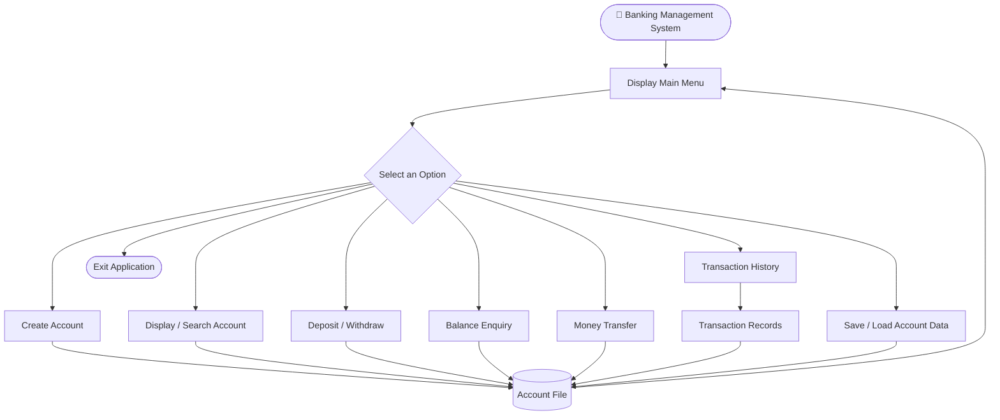

# Banking-Management-System
<p align="center">


</p>
<h1 align="center">
🏦 Banking Management System
</h1>
<p align="center">
A menu-driven Banking Management System developed using C programming.
<br>{=html} Manage bank accounts, deposits, withdrawals, balance
enquiries, money transfers, transaction history, and account records
using file handling.
</p>
📌 About the Project
The Banking Management System is a console-based C project that
performs basic banking operations. It uses structures, functions,
pointers, linked-list-based account management, modular source files,
and file handling to store and retrieve account information.

This project was developed as a practical way to learn and apply C
programming concepts.
✨ Features
   Option  Operation             Description
`c`    Create Account        Create a new bank account
`p`    Display Accounts      Display all available accounts
`s`    Search Account        Search using an account number
`d`    Deposit               Deposit money into an account
`w`    Withdraw              Withdraw money from an account
`b`    Balance Enquiry       Check the available account balance
`t`    Money Transfer        Transfer money between two accounts
`h`    Transaction History   View account transaction records
`r`    Save Information      Save account information to a file
`l`    Load Accounts         Load saved account information
`e`    Exit                  Terminate the application
🔄 Project Flow

# 🏦 Banking Management System

A menu-driven **Banking Management System** developed using the C programming language. This project allows users to manage bank accounts and perform basic banking operations through a simple menu-driven interface.

## 📌 Project Overview

The Banking Management System is a console-based application that provides basic banking functionalities such as creating accounts, displaying account details, searching accounts, depositing and withdrawing money, transferring funds, viewing transaction history, and saving/loading account information.

## ✨ Features

- Create New Account
- Display All Accounts
- Search Account
- Deposit Money
- Withdraw Money
- Balance Enquiry
- Money Transfer
- Transaction History
- Save Account Information
- Load Account Information

## 🛠️ Technologies Used

- C Programming Language
- GCC Compiler
- Makefile
- Linux / Ubuntu

## 🧠 C Concepts Used

- Structures
- Pointers
- Linked Lists
- Functions
- File Handling
- Dynamic Memory Allocation
- Modular Programming

## 📁 Project Structure

```text
Banking-Management-System/
│
├── main.c
├── account.c
├── transaction.c
├── banking.h
├── makefile
└── README.md
```

## ⚙️ Compilation and Execution

Open the terminal in the project directory.

**Compile the project:**

```bash
make
```

**Run the application:**

```bash
./a.out
```

## 📝 Makefile

```makefile
a.out : account.o main.o transaction.o
	cc account.o main.o transaction.o -o a.out

account.o : account.c
	cc -c account.c

main.o : main.c
	cc -c main.c

transaction.o : transaction.c
	cc -c transaction.c
```

---

# 💻 Sample Output

## 1. Main Menu and Account Creation

```text
c .createAccount p .display s .search d .deposite w .withdraw b .balance_enquiry t .transfer h .transaction_history l .loadAccount r .saveinformation e .exit

enter the choice: c

-------- CREATE NEW ACCOUNT --------
enter the name: Arti
enter the Account number: 123
enter the contact No: 9324747347
enter the balance: 10000

enter the choice: c

-------- CREATE NEW ACCOUNT --------
enter the name: Monika
enter the Account number: 992
enter the contact No: 9208274890
enter the balance: 20000

enter the choice: c

-------- CREATE NEW ACCOUNT --------
enter the name: Shrutika
enter the Account number: 923
enter the contact No: 9373929323
enter the balance: 30000

enter the choice: c

-------- CREATE NEW ACCOUNT --------
enter the name: Tanvi
enter the Account number: 564
enter the contact No: 3478940344
enter the balance: 900

enter the choice: c

-------- CREATE NEW ACCOUNT --------
enter the name: Sakshi
enter the Account number: 892
enter the contact No: 0982349382
enter the balance: 15000

enter the choice: c

-------- CREATE NEW ACCOUNT --------
enter the name: Tanuja
enter the Account number: 234
enter the contact No: 9320744334
enter the balance: 4000
```

## 2. Display All Accounts

```text
enter the choice: p

-------- DISPLAY BANK INFORMATION --------
Tanuja   234   9320744334   4000.000000
Sakshi   892   0982349382   15000.000000
Tanvi    564   3478940344   900.000000
Shrutika 923   9373929323   30000.000000
Monika   992   9208274890   20000.000000
Arti     123   9324747347   10000.000000
```

## 3. Search Account

```text
enter the choice: s

-------- SEARCH ACCOUNT --------
enter the account: 564
Tanvi 564 3478940344 900.000000
```

## 4. Deposit Money

```text
enter the choice: d

-------- DEPOSITE AMMOUNT --------
-------- SEARCH ACCOUNT --------
enter the account: 564
Tanvi 564 3478940344 900.000000
enter the new balance: 1000
Upadted Balance:1900.00
```

## 5. Withdraw Money

```text
enter the choice: w

-------- WITHDRAW MONEY --------
-------- SEARCH ACCOUNT --------
enter the account: 923
Shrutika 923 9373929323 30000.000000
enter the new Ammount: 1000
remaining balance:29000.00
```

## 6. Balance Enquiry

```text
enter the choice: b

-------- BALANCE ENQUIRY--------
-------- SEARCH ACCOUNT --------
enter the account: 234
Tanuja 234 9320744334 4000.000000
Available balanc:4000.000000
```

## 7. Money Transfer

**First Transfer: Monika to Arti**

```text
enter the choice: t

-------- TRANSFER MONEY --------
enter the sender account no:
-------- SEARCH ACCOUNT --------
enter the account: 992
Monika 992 9208274890 20000.000000

enter the receiver account no:
-------- SEARCH ACCOUNT --------
enter the account: 123
Arti 123 9324747347 10000.000000

enter the ammount: 2000

enter the choice: p

-------- DISPLAY BANK INFORMATION --------
Tanuja   234   9320744334   4000.000000
Sakshi   892   0982349382   15000.000000
Tanvi    564   3478940344   1900.000000
Shrutika 923   9373929323   29000.000000
Monika   992   9208274890   18000.000000
Arti     123   9324747347   12000.000000
```

**Second Transfer: Sakshi to Tanuja**

```text
enter the choice: t

-------- TRANSFER MONEY --------
enter the sender account no:
-------- SEARCH ACCOUNT --------
enter the account: 892
Sakshi 892 0982349382 15000.000000

enter the receiver account no:
-------- SEARCH ACCOUNT --------
enter the account: 234
Tanuja 234 9320744334 4000.000000

enter the ammount: 1000

enter the choice: p

-------- DISPLAY BANK INFORMATION --------
Tanuja   234   9320744334   5000.000000
Sakshi   892   0982349382   14000.000000
Tanvi    564   3478940344   1900.000000
Shrutika 923   9373929323   29000.000000
Monika   992   9208274890   18000.000000
Arti     123   9324747347   12000.000000
```

## 8. Transaction History

**Arti – Account 123**

```text
enter the choice: h

-------- SEARCH ACCOUNT --------
enter the account: 123
Arti 123 9324747347 12000.000000
-------- TRANSACTION HISTORY --------
1 TRANSFER IN 2000.00
```

**Tanuja – Account 234**

```text
enter the choice: h

-------- SEARCH ACCOUNT --------
enter the account: 234
Tanuja 234 9320744334 5000.000000
-------- TRANSACTION HISTORY --------
1 TRANSFER IN 1000.00
```

**Sakshi – Account 892**

```text
enter the choice: h

-------- SEARCH ACCOUNT --------
enter the account: 892
Sakshi 892 0982349382 14000.000000
-------- TRANSACTION HISTORY --------
1 TRANSFER OUT 1000.00
```

**Tanvi – Account 564**

```text
enter the choice: h

-------- SEARCH ACCOUNT --------
enter the account: 564
Tanvi 564 3478940344 1900.000000
-------- TRANSACTION HISTORY --------
1 DEPOSITE 1000.00
```

**Shrutika – Account 923**

```text
enter the choice: h

-------- SEARCH ACCOUNT --------
enter the account: 923
Shrutika 923 9373929323 29000.000000
-------- TRANSACTION HISTORY --------
1 WITHDRAW 1000.00
```

**Monika – Account 992**

```text
enter the choice: h

-------- SEARCH ACCOUNT --------
enter the account: 992
Monika 992 9208274890 18000.000000
-------- TRANSACTION HISTORY --------
1 TRANSFER OUT 2000.00
```

## 9. Save Account Information

```text
enter the choice: r

store information successfully...
```

## 10. Load Account Information

```text
enter the choice: l

Accounts loaded successfully!
```

## 11. Display Accounts After Loading

```text
enter the choice: p

-------- DISPLAY BANK INFORMATION --------
Tanuja   234   9320744334   5000.000000
Sakshi   892   0982349382   14000.000000
Tanvi    564   3478940344   1900.000000
Shrutika 923   9373929323   29000.000000
Monika   992   9208274890   18000.000000
Arti     123   9324747347   12000.000000
```

## 12. Exit Application

```text
enter the choice: e
```

---

## 🚀 Future Enhancements

The following features can be added in future versions:

1. **User Authentication:** Add login functionality for secure access.
2. **Password Protection:** Protect customer accounts with passwords.
3. **PIN-based Transactions:** Add PIN verification before transactions.
4. **Update Account Details:** Allow users to update their personal information.
5. **Delete Account:** Provide an option to close an account.
6. **Mini Statement:** Generate a statement of recent transactions.
7. **Improved Transaction History:** Store and display more transaction records.
8. **Duplicate Account Validation:** Prevent creation of accounts with duplicate account numbers.
9. **Admin Panel:** Add administrative controls to manage bank accounts.
10. **Input Validation:** Improve validation for account numbers, contact numbers, and transaction amounts.
11. **Improved File Handling:** Make account data storage and retrieval more robust.
12. **User-Friendly Interface:** Develop a graphical user interface (GUI).

## 👨‍💻 Author

**Your Name**

## ⚠️ Disclaimer

This project is developed for educational purposes as a C programming project. It is a basic banking simulation and is not intended for real financial transactions.

